# CRAD: Class-wise Reliability-Aware Distillation for Decentralized Heterogeneous Federated Learning
---

## Overview
Official PyTorch implementation of paper: "CRAD: Class-wise Reliability-Aware Distillation for Decentralized Heterogeneous Federated Learning". https://arxiv.org/abs/2609.00446
---

### Abstract
Conventional federated learning (FL) relies on parameter averaging, which forces clients to be doubly homogeneous: it demands an identical architecture and degrades under non-IID data. Real-world deployments usually break both assumptions. We sidestep both by building a decentralized knowledge distillation framework in which each client evaluates its peers' model snapshots on its own local data and distills from the resulting soft predictions. Because knowledge is transferred through the shared class posterior, clients are free to run different architectures; and because every teacher is evaluated on the student's own device, raw data never leaves the client, with no central server or public dataset required. Within this setting, we identify and address an under-examined problem: how to combine the peer teacher predictions. Existing methods, like uniform averaging, ignore how knowledge reliability varies across teachers and classes. We propose Class-wise Reliability-Aware Distillation (CRAD), which, per class, first discards teachers that disagree with the peer consensus and then takes a weighted average of the rest, weighting each teacher by its per-class reliability (precision, or inverse variance). Since the variance of an accuracy from n samples scales as 1/n, support enters automatically: among the teachers that survive filtering, a teacher is trusted for a class to the degree that it is both accurate and well-evidenced for it. On three image-classification benchmarks (CIFAR-10, CIFAR-100, and PathMNIST colon pathology), across heterogeneous architectures under severe non-IID skew, CRAD consistently outperforms competing methods in global accuracy.

---

## Framework Overview

<p align="center">
  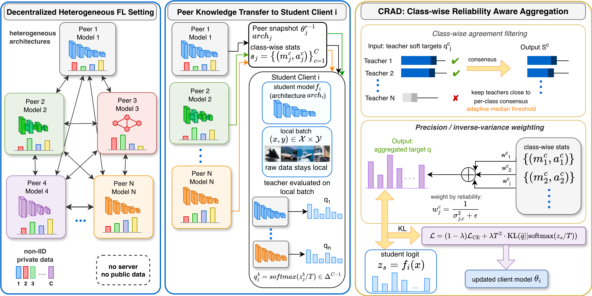
</p>

> **Figure 1.** Overview of the proposed CRAD framework. **(1) Decentralized heterogeneous setting:** clients running different architectures collaborate over non-IID private data, with no central server and no public dataset; the only shared interface between any two clients is the $C$-dimensional class posterior. **(2) Peer knowledge transfer:** a student client receives its peers' model snapshots together with a compact per-class statistics vector, and runs each peer on its own local batch to obtain soft predictions $q_j$, so raw (and often private) data never leaves the client. **(3) Class-wise reliability-aware aggregation:** for each class, CRAD first discards the teachers that disagree with the peer consensus (an adaptive per-class median filter), then combines the survivors by precision (inverse-variance) weighting of their class-accuracy estimates, so that decisive, well-supported teachers dominate the aggregated distillation target $\bar{q}$. The student then updates its model by minimizing a combination of cross-entropy on its local labels and a distillation loss toward this target.

---

## Two-Stage Aggregation Mechanism & Qualitative Case Study

| (a) Validation Support Counts ($n_j^c$) | (b) Per-Client Global Test Accuracy (%) |
| :---: | :---: |
| 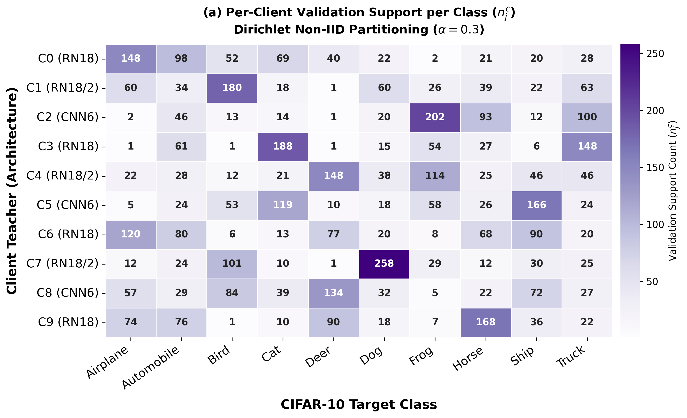 | 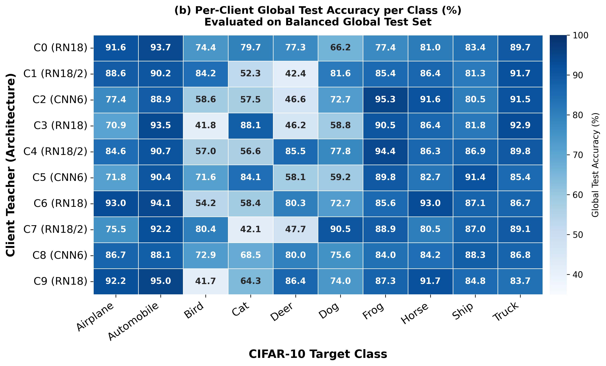 |
| **(c) Success Case (Bird Image #9381)** | **(d) Failure Case (Dog Image #128)** |
| 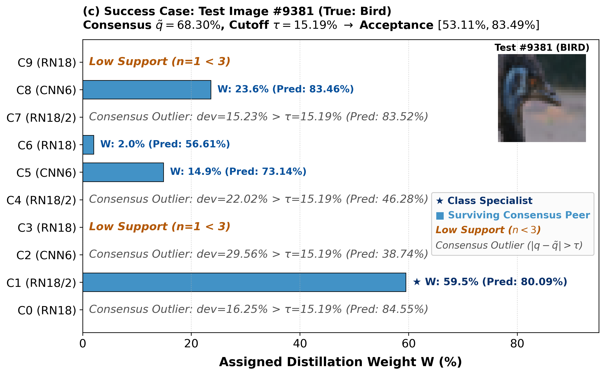 | 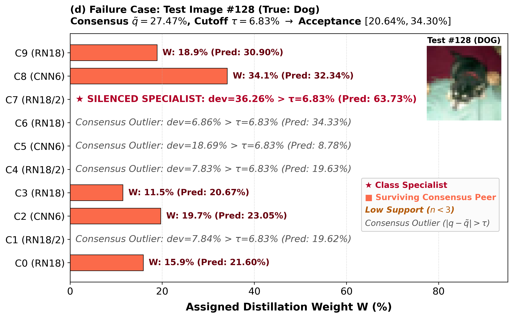 |

> Figure 2. CRAD’s two-stage aggregation traced on two individual CIFAR-10 test images. W is the assigned distillation weight after per-class normalization, and the parenthesized value is the client’s probability on the true class. (c) Success case, a bird image: teachers with a single sample of the class are dropped as uninformed, four more fall outside the acceptance band ˜qc ± τc and are dropped as consensus outliers, and the surviving well-supported specialist (C1, n = 180) receives 59.5% of the weight, raising the aggregated target on the true class to 79.4% from a preliminary consensus of 68.3%. (d) Failure case, a dog image: the best-evidenced teacher (C7, n = 258, and correct at 63.7%) deviates from a low consensus formed by less informed peers and is removed by Stage 1, so its knowledge never reaches Stage 2 and the target stays at 27.2%.

---

## Experimental Results

### Main Benchmark Performance

<p align="center">
  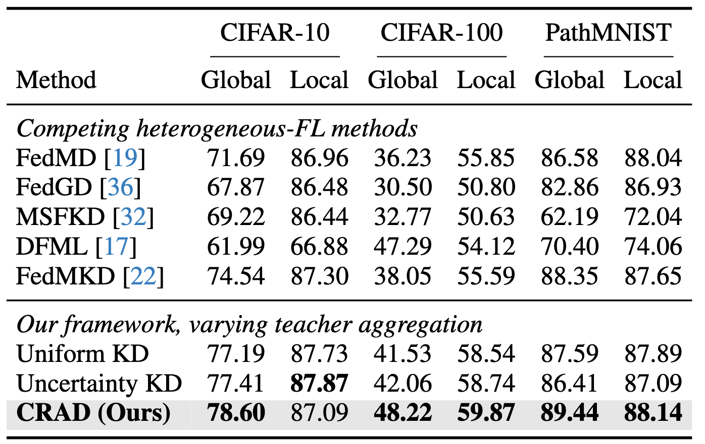
</p>

> Table 1. Teacher-aggregation comparison on CIFAR-10, CIFAR-100 and PathMNIST (N = 10, non-IID Dirichlet, R = 300). All decentralized-KD methods share the identical backbone and distillation weight λ = 0.7, differing only in how peer teachers are combined; the checkpoint is selected on each client’s validation split. CRAD’s support threshold nc min is the per-class peer median on CIFAR-10 and CIFAR-100, and the 20th percentile (retaining the top 80% of teachers) on PathMNIST. Accuracies are percentages, with global accuracy the primary metric. Best aggregation result in each column in bold

---

### Communication & Computation Cost Comparison

<p align="center">
  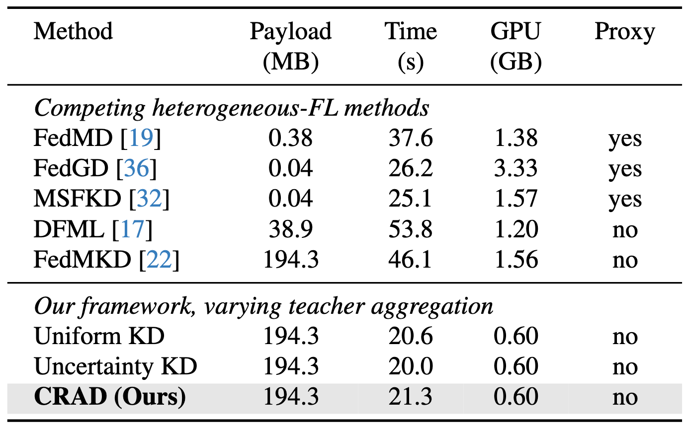
</p>

> Table 2. Cost on CIFAR-10 (N = 10), measured under the setup of Table 1 on identical hardware. Payload is what one client transmits per round and GPU its peak resident memory; Time is the wall-clock duration of a full communication round. “Proxy” marks methods additionally requiring public or synthetic data.

---

### Per-Class Performance & Convergence Analyses

<p align="center">
  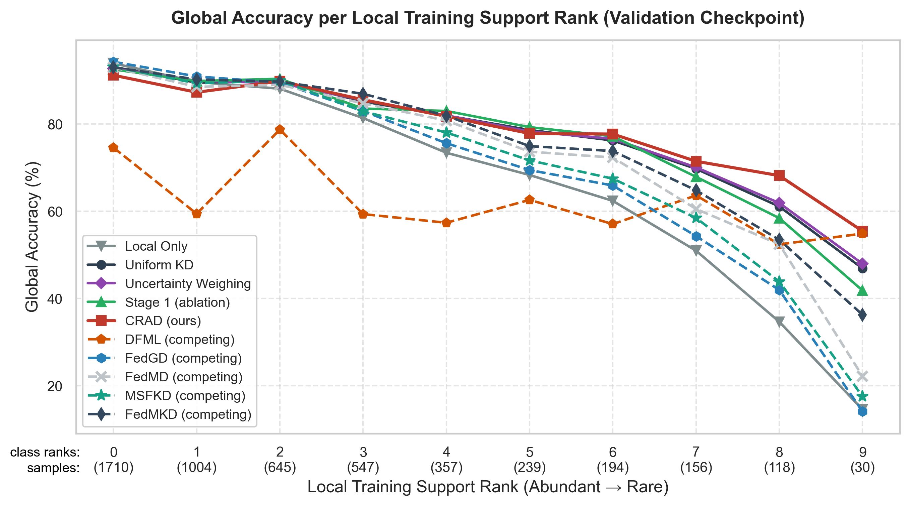
</p>

> Figure 2. Per-class global accuracy on CIFAR-10 with classes ordered by local training support (shown in the parentheses, abundant to rare), for all compared methods. The methods agree more on well-supported classes and separate on the rare ones, where CRAD degrades the least

<p align="center">
  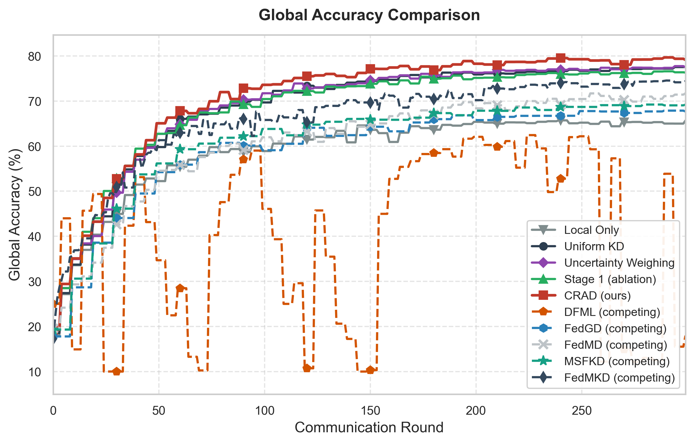
</p>

> Figure 3. Global accuracy vs. communication round for all compared methods on CIFAR-10. CRAD (red) stays above every other method from the early rounds onward and converges stably, whereas DFML swings sharply from round to round

---

## Installation & Quickstart

### 1. Environment Setup

```bash
# Clone the repository
git clone https://github.com/bbilbeis/DFL-KD.git
cd DFL-KD

# Create and activate virtual environment (Python 3.10 – 3.12 recommended for PyTorch wheels)
python3.12 -m venv .venv
source .venv/bin/activate

# Install dependencies
pip install -r requirements.txt
```

### 2. Run Paper Experiments

You can reproduce the paper results for any dataset using a single, one-line command with no arguments:

```bash
# CIFAR-10 Benchmark (CRAD)
python run/run_crad_cifar10.py        # or: ./run/run_crad_cifar10.sh

# CIFAR-100 Benchmark (CRAD)
python run/run_crad_cifar100.py       # or: ./run/run_crad_cifar100.sh

# PathMNIST Benchmark (CRAD)
python run/run_crad_pathmnist.py      # or: ./run/run_crad_pathmnist.sh
```

<details>
<summary><b>Click to view equivalent full explicit CLI commands</b></summary>

#### CIFAR-10 Benchmark (CRAD - Ours)
```bash
python experiments/main.py \
  --algorithm TypicalKD \
  --idea 4.3_pre_v0 \
  --adaptive_pre_filter \
  --val_test_protocol option_a \
  --k_zero_strategy drop \
  --fix_eq6 \
  --dataset cifar10 \
  --num_clients 10 \
  --num_rounds 300 \
  --alpha_kd 0.7 \
  --partition_alpha 0.3 \
  --T 4.0 \
  --cs full \
  --lr 0.1 \
  --seed 1024 \
  --use_global_test \
  --fast_eval \
  --name "CRAD_cifar10_paper"
```

#### CIFAR-100 Benchmark (CRAD - Ours)
```bash
python experiments/main.py \
  --algorithm TypicalKD \
  --idea 4.3_pre_v0 \
  --adaptive_pre_filter \
  --val_test_protocol option_a \
  --k_zero_strategy drop \
  --fix_eq6 \
  --dataset cifar100 \
  --num_clients 10 \
  --num_rounds 300 \
  --alpha_kd 0.7 \
  --partition_alpha 0.3 \
  --T 4.0 \
  --cs full \
  --lr 0.1 \
  --seed 1024 \
  --use_global_test \
  --fast_eval \
  --name "CRAD_cifar100_paper"
```

#### PathMNIST Benchmark (CRAD - Ours)
```bash
python experiments/main.py \
  --algorithm TypicalKD \
  --idea 4.3_pre_v0 \
  --adaptive_pre_filter \
  --pre_filter_percentage 0.80 \
  --val_test_protocol option_a \
  --k_zero_strategy drop \
  --fix_eq6 \
  --dataset pathmnist \
  --num_clients 10 \
  --num_rounds 300 \
  --alpha_kd 0.7 \
  --partition_alpha 0.3 \
  --T 4.0 \
  --cs full \
  --lr 0.1 \
  --seed 1024 \
  --use_global_test \
  --fast_eval \
  --name "CRAD_pathmnist_paper"
```

*(Optional: Add `--parallel` to any command to enable parallel client training across CPU cores or multiple GPUs).*

#### Baselines
* **Uniform KD:** Replace `--idea 4.3_pre_v0 --adaptive_pre_filter` with `--idea baseline`.
* **Uncertainty KD:** Replace `--idea 4.3_pre_v0 --adaptive_pre_filter` with `--idea idea3`.

</details>

---

## Ablation Studies

### Client Scaling & Partial Participation ($N = 20, 50, 100$)

To evaluate scalability when the client population expands and participation becomes sparse, we evaluate client pools of $N \in \{20, 50, 100\}$ on CIFAR-10, activating a random subset of 10 clients per communication round:

<p align="center">
  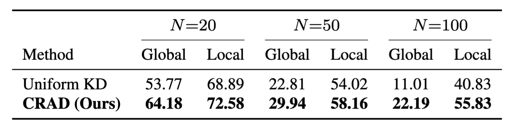
</p>

> **Table 3.** Client-number ablation on CIFAR-10 with partial participation. Each run uses $R=300$ rounds and activates 10 clients per round. Global accuracy is averaged over all clients. Under increasing scale and data fragmentation, naive uniform distillation collapses due to aggregating mostly misinformed teachers. CRAD preserves over $2\times$ the global accuracy of Uniform KD at $N=100$.

---

### Teacher Weighting Rules on CIFAR-100

We ablate the aggregation weighting function within the CRAD framework on CIFAR-100 across 7 mathematical formulations:

<p align="center">
  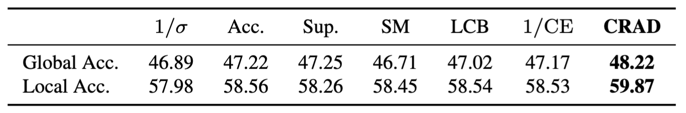
</p>

> **Table 4.** Ablation of teacher-weighting rules on CIFAR-100. All variants use the same CRAD framework and differ only in the aggregation weight. Acc.: accuracy-only; Sup.: support-only; SM: $\mathrm{softmax}(-\sigma^2)$; LCB: $\max(0,\tilde a-\sigma)$; $\mathrm{CE}$: cross-entropy.

---

## Citation

If you find this work useful in your research, please cite our paper:

```bibtex
@article{bilbeisi2026crad,
  title={CRAD: Class-wise Reliability-Aware Distillation for Decentralized Heterogeneous Federated Learning},
  author={Bilbeisi, Baraa and Fan, Mengchen and Geng, Baocheng and Tian, Qing},
  journal={arXiv preprint arXiv:2609.00446},
  year={2026},
  url={https://arxiv.org/abs/2609.00446}
}
```
